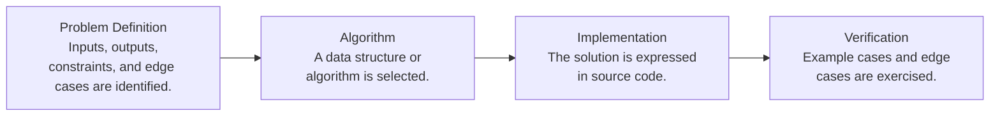

# Leetcode POTD

A collection of daily coding problem submissions and supporting documentation.

## Overview

This repository is maintained as a learning project or technical archive. It documents an implementation area, a set of practical exercises, or an experiment while preserving a focused and inspectable project structure.

## Key Features

- Self-contained implementation
- Browser or tool-based interaction
- Reusable project structure
- Clear input-to-output workflow

## Technology Stack

| Area | Technology |
|---|---|
| Library / Framework / Tool | Repository-specific tooling |

## Architecture and Data Flow

| Stage | Responsibility |
|---|---|
| **Problem Definition** | Inputs, outputs, constraints, and edge cases are identified. |
| **Algorithm** | A data structure or algorithm is selected. |
| **Implementation** | The solution is expressed in source code. |
| **Verification** | Example cases and edge cases are exercised. |

## Setup

1. Review the repository structure and applicable runtime requirement.
2. Open the entry-point file in an editor or IDE.
3. Run or open it using the tool required for the project language.

## Usage

Compile or run the relevant source file and provide the required input where applicable.

## Configuration

No mandatory repository-specific configuration is documented by the project structure. Environment or runtime options may be defined inside the relevant entry-point file or platform settings.

## Verification

- Run the project entry point and verify the primary success and error paths.
