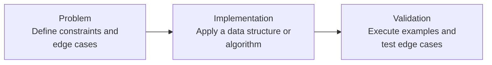

# Leetcode POTD

**Learning archive** · A collection of daily LeetCode problem submissions.

## Overview

A collection of daily LeetCode problem submissions.

## Technology Stack

- `Tools and configuration`

## How the Repository Works

| Stage | Responsibility |
|---|---|
| **Problem** | Define constraints and edge cases |
| **Implementation** | Apply a data structure or algorithm |
| **Validation** | Execute examples and test edge cases |

## Concepts Covered

- Daily problem-solving
- Data structures
- Algorithmic patterns
- Edge-case analysis

## Recruiter Summary

This repository shows hands-on practice, iterative learning, and problem-solving across the technologies listed above. It is most useful as evidence of foundational growth and experimentation rather than as a production release.

---

Documentation is concise and project-focused; source code was not modified.
